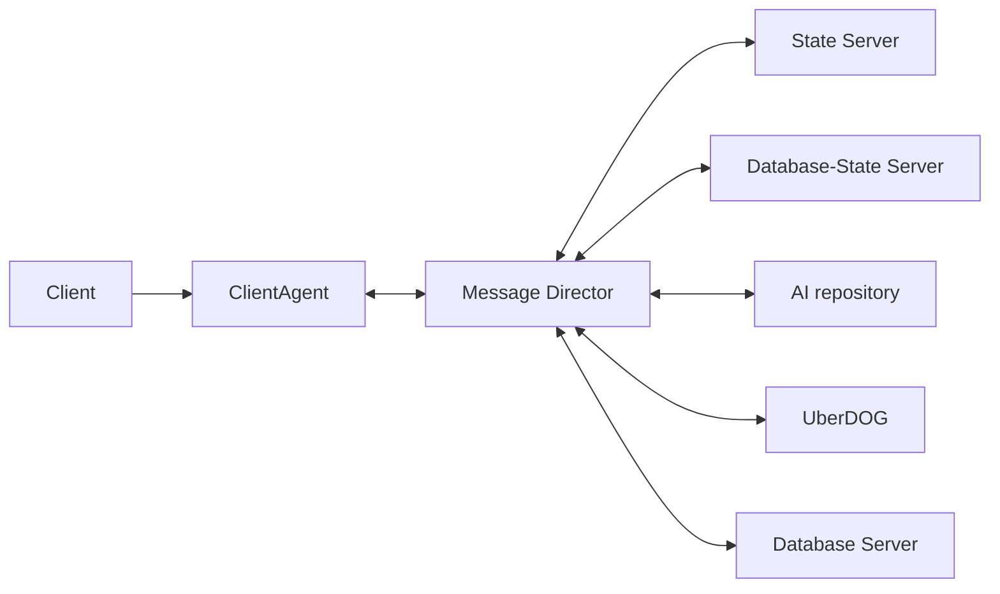

# Distributed objects and OTP-style game flow

## The pieces

A distributed object (DO) is a logical game object with an ID, fields, and a parent/zone location. A DC file is the shared contract that names its classes, fields, and permissions. Each process creates its own local Python view of a DO; the ID and DC contract connect those views.

## Direct, OTP and Astron

These layers work together:

| Layer | What it contributes |
|---|---|
| Panda Direct | DO/DC contracts and the object lifecycle. |
| OTP-style game architecture | Application conventions for object roles, global managers, and the login-to-world lifecycle. |
| Astron | Backend services for client connections, message routing, object state/location, interests, and database fields. |

Here, OTP means the Toontown/Disney-style game architecture around distributed objects, not a separate transport protocol. The stock CMU path demonstrates the basic client/server DO model; OTP organizes an MMO world around it through separate object perspectives, global services, world hierarchy, and AI-owned shards. Those perspectives assign work: the client renders, the Owner View receives owner-only commands, the AI owns simulation, and UberDOG handles global services such as login. Parent/zone relationships describe the world; interest selects which parts each client sees. A single avatar ID can therefore have client, Owner View, and AI perspectives with separate jobs.

In this demo, the world is `GameGlobals → District → objects`; grid mode inserts a Cartesian Grid between the District and its cell children. The login manager and avatar perspectives show selected OTP-style conventions.

The [interest guide](interest.md#the-interest-models-differ) compares the stock CMU and OTP/Astron interest models. The self-contained [`demo/networking`](../demo/networking) package connects Direct's Python repositories to Astron's protocol.

## Scaling and load distribution

Astron roles are logical services, not one-process-per-role requirements. This demo runs the Message Director, ClientAgent, State Server, Database Server, and DBSS in one `astrond` daemon. A larger deployment can split roles across processes or hosts to give client connections, message routing, live state, simulation, global services, and persistence separate capacity.

The stock CMU `ServerRepository` keeps its zone-to-client map and fan-out in one relay, and does not keep current field values. A CMU game can distribute simulation across servers too, but must build the shard directory, inter-server message routing, object-ownership rules, and state/snapshot path it needs. Astron's Message Director routes channel traffic among the services, while its State Server keeps live object state and answers interest snapshots. This gives the game a ready-made path for separate AI shards to work with the same client and object services.

The AI server implements the game's shard logic and owns the objects in its shard. Running several AI servers with different world partitions can spread simulation load; the Message Director routes messages to the channels for the objects and services involved. ClientAgent interest subscriptions limit which clients receive location updates. Together, shard ownership and interest keep simulation and client update work scoped to the world each process and player needs.

The application and its network deployment assign players to services; Astron routes their messages after assignment:

- A network load balancer or connection directory can distribute new TCP connections across ClientAgent endpoints. Each ClientAgent manages its sessions on the shared Message Director network.
- Game login or shard-directory code can track shard availability and population, then select an AI shard for a player. Production games commonly keep this choice in their own login and district workflow.
- The game must coordinate object authority, interests, and cleanup when moving a player between shards. Adding processes also requires deliberate channel and object-range assignments.

This repo's launchers start one AI and one Astron daemon with several roles. The demo shows the routing, state, and interest primitives used by a multi-shard deployment; shard assignment and player distribution are game and deployment policy.

## Login and avatar creation

1. The client completes Astron's hello exchange, then calls `DemoLoginManager.login` with a display name.
2. `DemoLoginManagerUD` moves the Client Agent connection to `ESTABLISHED`, opens the GameGlobals management interest, then opens District main interest after the first completion callback.
3. After the District interest completes, the AI creates the avatar. The default path generates it in District main; the grid path generates it directly in its Cartesian cell. The AI registers it as the client's session object, assigns the client as owner, and sets its AI authority.
4. The owner gets a `DemoAvatarOV`, which handles movement commands and creates the local visual avatar. Other interested clients generate a regular `DemoAvatar`.

The avatar's Owner View sends movement intent with `requestMove`. The Client Agent restricts that call to the owner. The AI validates the direction and updates position. `setPosition` broadcasts coordinates to clients interested in the avatar's location; its `ownrecv` permission also sends the update to the owner independently of ordinary zone interest. Clients render the state they receive; they do not choose the authoritative position.

Owner Views live in `doId2ownerView`, separately from the normal client-object map `doId2do`. The demo's client repository handles location messages for both maps so the owner's local view gets updated location metadata without being added to interest tracking. `ownrecv` field updates also keep that Owner View current when its ordinary DO leaves interest. An ordinary `CLIENT_OBJECT_LEAVING` removes the normal DO through Direct's `deleteOrDelay()` lifecycle; it does not remove the separately tracked Owner View.

## How production expands this flow

This demo accepts a display name and creates one session avatar in one District. Production games commonly add account lookup, avatar roster and selection, shard discovery, and persistent player assets. A typical flow adds a few important rules:

- **Verify identity and ownership.** UberDOG derives the account from the requesting connection, then checks that the selected avatar belongs to it.
- **Treat database work as asynchronous.** Account and avatar records arrive through callbacks. Global managers correlate those responses and guard against overlapping operations for the same account.
- **Separate session from persistence.** The AI creates the live avatar for the session. Persistent assets such as ships are loaded or activated from the database and associated with that avatar; disconnect removes the session object while database fields survive. A persistent object can also be activated for server-side work while its owner is offline; see [the persistence guide](persistence.md#applying-server-side-logic-to-offline-data).
- **Coordinate world transitions.** Moving between shards or districts involves object ownership, old and new interests, and cleanup as well as changing a zone.

These are game workflows that can be built over CMU or Astron. Astron's ClientAgent, Message Director, State Server, AI, UberDOG, and database roles give them separate service boundaries; they do not implement the game's account, avatar, or travel rules.

## DC field permissions

| Field | Direction and flags | Purpose |
|---|---|---|
| `login` | `clsend` | Client requests login through the global login object. |
| `createAvatar` | `airecv` | UberDOG routes avatar creation to the AI. |
| `requestMove` | `ownsend airecv` | Only the owner can send movement intent; AI receives it. |
| `setPosition` | `required broadcast ownrecv ram` | AI-authored position is sent to interested clients and the owner, and included at generation. |
| `setActivationCount` | `required broadcast ram db` | Beacon count is sent at generation, replicated at runtime, and stored by DBSS. |

`required` controls initial state sent when an object is generated. `broadcast` sends updates to clients that know the object; `ownrecv` sends updates to its owner. `ram` keeps state in the running State Server; `db` also writes the field to the database. `clsend` and `ownsend` describe client-send permissions; here, `airecv` marks the AI as a receiver. The stock CMU `ServerRepository` does not provide that separate AI route.

### Protocol checks and game authorization

These field flags are protocol-level checks, and each backend enforces them through its own server code:

- **Astron ClientAgent** checks that the object and field are valid, that the field is client-sendable (`clsend`, or `ownsend` when this connection owns the object), and that the values satisfy the DC constraints. Server code can also grant a client permission to send specific fields. Before a client is established, object field updates are limited to configured anonymous UberDOG objects.
- **Stock CMU `ServerRepository`** has a server-side check too. It rejects updates from a non-owner unless the field is `clsend` or `p2p`, then routes `p2p`, `broadcast`, or `reflect` updates. That is a narrower, different check: it gates non-owner sends, but does not apply Astron's `ownsend` rule to owner-originated updates or provide the ClientAgent's session and dynamic field-send controls.
- **Interest and location requests are also different.** Astron's ClientAgent can disable client-managed interests or require their parent to be visible; this demo sets `add_interest: enabled` so the client-led example can open its grid window. Client-originated location changes are disabled by default, and when enabled the ClientAgent accepts them only for objects owned by that connection. The CMU `ServerRepository` accepts a client's flat zone list without a visible-parent policy, but only lets that client change zones for objects in its own object map.

Neither backend's field flags establish account identity or prove that an account owns a persistent avatar or asset. Game-server code must validate the authenticated account, ownership, and requested action; in OTP/Astron, those checks typically live in UberDOG and AI logic. For example, `ownsend` means the connection owns that distributed object; it does not prove that the account is entitled to rename a saved ship or that a movement request is valid.

## Source map

| Area | Files |
|---|---|
| DC contract | [`demo/astron/dclass/demo.dc`](../demo/astron/dclass/demo.dc) |
| Client login, input, and interest | [`demo/client.py`](../demo/client.py) |
| Login and session-object setup | [`demo/objects.py`](../demo/objects.py), [`demo/ud_server.py`](../demo/ud_server.py) |
| District, avatar authority, and zone changes | [`demo/objects.py`](../demo/objects.py), [`demo/ai_server.py`](../demo/ai_server.py) |
| Live client-side object inspection | [`demo/inspect.py`](../demo/inspect.py) |
